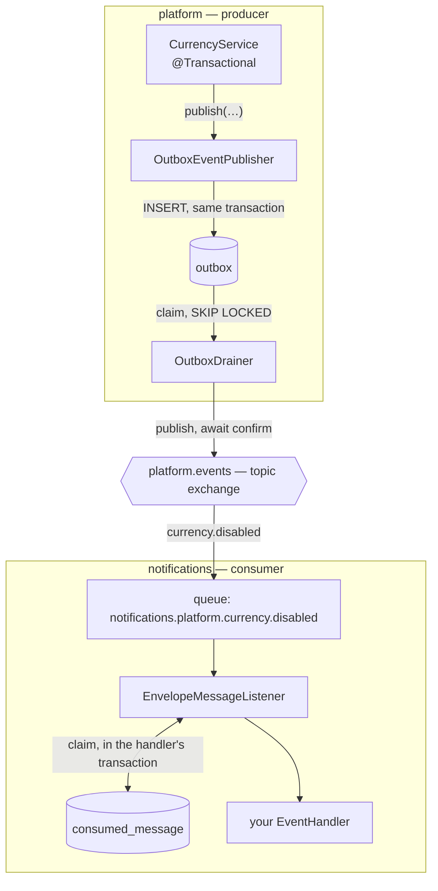
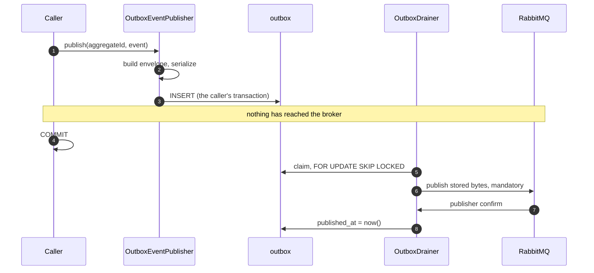
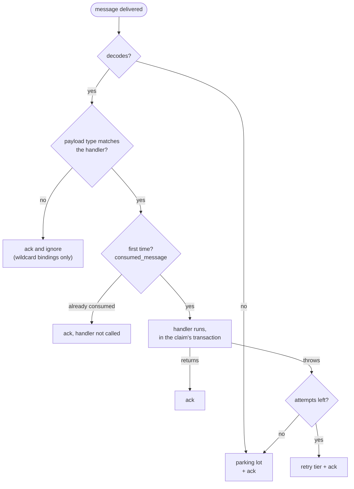
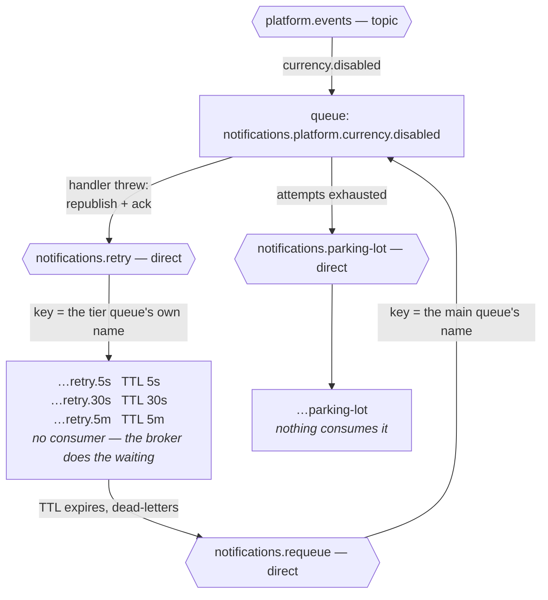

# common-amqp

Asynchronous communication between Confluo services, over RabbitMQ.

A library, not a service. A service depends on the jar and declares `@EnableAmqp`; nothing happens
to a service that merely has it on the classpath. Delivery is **at-least-once in both directions**:
an event is written to the database in the same transaction as the change it describes and published
afterwards, and a consumer records what it has handled so a repeat delivery is recognised rather
than processed twice.

---

## The two things you write

**Publishing** — inside the transaction that makes the change:

```java
@Service
@RequiredArgsConstructor
@Transactional
public class CurrencyService {

    private final EventPublisher eventPublisher;

    public CurrencyResponse disable(UUID id) {
        Currency currency = /* ... load and change it ... */;
        eventPublisher.publish(currency.getId(),
                new CurrencyDisabledEvent(currency.getId(), currency.getDisabledAt()));
        return mapper.toResponse(currency);
    }
}
```

**Consuming** — one bean per event:

```java
@Component
@RequiredArgsConstructor
public class OnCurrencyDisabled implements EventHandler<CurrencyDisabledEvent> {

    private final OfferingService offerings;

    @Override
    public String producer() {
        return "platform";
    }

    @Override
    public void handle(EventEnvelope<CurrencyDisabledEvent> envelope) {
        offerings.stopOffering(envelope.payload().currencyId());
    }
}
```

That is the whole API. The queue, its bindings, the retry tiers, the parking lot, the listener
container, the acknowledgements and the duplicate check are all derived from the type parameter and
the producer's name.

**Contracts** live in `event/<domain>/` and are annotated records:

```java
@DomainEvent(aggregate = "currency", event = "disabled")
public record CurrencyDisabledEvent(UUID currencyId, Instant disabledAt) {}
```

The annotation is the single source of truth for the routing key (`currency.disabled`) and the
envelope's `eventType`, so no routing key is ever passed by hand.

---

## How an event travels



Nothing crosses the broker before the producer's transaction commits, and nothing is marked
published until the broker has confirmed it.

---

## Package map

| package | what is in it |
|---|---|
| `event` | `@DomainEvent`, `EventEnvelope`, `EventTypeRegistry`, and the converter that turns an envelope into a message and back |
| `event/<domain>` | the event contracts themselves, one package per producing domain |
| `publish` | `EventPublisher` (the API), `OutboxEventPublisher` (writes to the outbox), `ConfirmedPublisher` and `RabbitEventSender` (the only classes that touch the broker) |
| `outbox` | `OutboxEntry`, `OutboxRepository` + its JDBC implementation, and `OutboxDrainer` (the nudge and the sweep) |
| `consume` | `EventHandler` (the API), `Subscription`, `EventHandlerRegistrar`, `EnvelopeMessageListener`, `ConsumedMessageStore` + implementation, and the purger |
| `retry` | `RetryTopology` (the shape) and `RetryRepublishingErrorHandler` (what happens on failure) |
| `topology` | `AmqpNames` — every exchange and queue name, derived from the service name — and `QueueArguments` |
| `config` | `AmqpProperties` and the four configurations `@EnableAmqp` imports |
| `metrics`, `health` | `AmqpMetrics` and `OutboxHealthIndicator` |

`@EnableAmqp` imports four configurations, each covering one concern:

| configuration | brings | switched off by |
|---|---|---|
| `AmqpConfiguration` | properties, contract registry, converter, template customiser, metrics | — |
| `TopologyConfiguration` | `AmqpNames`, `RetryTopology`, this service's own events exchange | — |
| `OutboxConfiguration` | the publishing half: repository, sender, publisher, drainer, health | `confluo.amqp.outbox.enabled=false` |
| `ConsumerConfiguration` | the consuming half: ledger, queues, listener containers, purger | `confluo.amqp.consumer.enabled=false` |

A consumer-only service turns the outbox off. A service with no handlers needs no switch — it
declares no queues and starts no containers either way.

---

## Publishing, in detail



Two triggers drain the outbox. The **nudge** runs immediately after the writing transaction commits,
so the usual case costs no waiting. The **sweep** runs on a timer and is what makes the design
correct rather than merely quick — it recovers anything the nudge could not send because the process
died, the broker was down, or the publish was refused.

Every instance runs both. There is no leader election and no lock table: `claimPending` locks the
rows it takes and skips rows another instance holds.

---

## Consuming, in detail

Acknowledgement is manual, so each outcome is decided explicitly rather than inferred from whether a
method returned.



The claim and the handler share **one** transaction. That is what makes a retry a real retry: a
handler that throws rolls back its own claim, so the next delivery is not skipped as a duplicate.

A message that cannot be decoded is never retried — it will not become readable.

---

## Topology and the retry journey

One set of objects per subscription, all named from the service name:



The shape is worth following, because the obvious version does not work. A failing handler **cannot
simply nack**: a nacked message is dead-lettered with the routing key it arrived with, so nacking
cannot choose between a five-second and a five-minute wait. Instead the message is republished to
`<service>.retry` keyed by the tier queue's own name, and acked. The tier holds it — no consumer, a
queue-level TTL — and on expiry dead-letters it to `<service>.requeue`, where a **second binding** on
the main queue brings it back. The wait happens in the broker, so no consumer thread and no prefetch
slot is held, and a redeploy mid-backoff loses nothing.

| failure | goes to | waits |
|---|---|---|
| 1st | `…retry.5s` | 5s |
| 2nd | `…retry.30s` | 30s |
| 3rd | `…retry.5m` | 5m |
| 4th | `…parking-lot` | forever — nothing consumes it |

There is one delay per retry, so `retry-delays` always has one fewer entry than `max-attempts`. A
mismatch is a startup failure rather than something discovered on the first error.

A parked message carries `x-confluo-parked-reason`, so whoever finds it in the management UI does
not need the log to know why it is there.

### Naming

| object | pattern | example |
|---|---|---|
| producer exchange | `<service>.events` | `platform.events` |
| routing key | `<aggregate>.<event>` | `currency.disabled` |
| consumer queue | `<consumer>.<producer>.<aggregate>.<event>` | `notifications.platform.currency.disabled` |
| retry tier | `<queue>.retry.<delay>` | `…currency.disabled.retry.30s` |
| parking lot | `<queue>.parking-lot` | `…currency.disabled.parking-lot` |

Verbose on purpose: a queue in the management UI should say who listens, who publishes, and to what,
because that is what a person needs when they find it backed up.

---

## Configuration

Broker connection details stay under Spring's own `spring.rabbitmq.*`. Everything else:

| property | default | |
|---|---|---|
| `confluo.amqp.service-name` | `${spring.application.name}` | every exchange and queue name derives from it |
| `confluo.amqp.queue-type` | `classic` | `quorum` when deployed; **cannot be changed after a queue is declared** |
| `confluo.amqp.confirm-timeout` | `5s` | both halves publish and both block on it |
| `confluo.amqp.outbox.enabled` | `true` | `false` for a consumer-only service |
| `confluo.amqp.outbox.batch-size` | `100` | rows per drain |
| `confluo.amqp.outbox.poll-interval` | `1s` | the sweep's interval |
| `confluo.amqp.outbox.max-attempts` | `10` | then the row is left alone and logged at `ERROR` |
| `confluo.amqp.outbox.stale-after` | `1m` | how old the oldest pending row may get before health reports degraded |
| `confluo.amqp.consumer.enabled` | `true` | |
| `confluo.amqp.consumer.prefetch` | `20` | |
| `confluo.amqp.consumer.concurrency` | `2` | `max-concurrency` `8` |
| `confluo.amqp.consumer.max-attempts` | `4` | |
| `confluo.amqp.consumer.retry-delays` | `5s, 30s, 5m` | one per retry |
| `confluo.amqp.consumed-message.retention` | `30d` | `purge-cron` `0 15 3 * * *` |

Two settings in `spring.rabbitmq.*` are **not optional**:

```yaml
spring:
  rabbitmq:
    publisher-confirm-type: correlated   # the drainer has nothing to wait for without it
    publisher-returns: true
    listener:
      simple:
        default-requeue-rejected: false  # the default, true, spins poison messages
```

### Schema

Every service using this module adds the shipped migration location:

```yaml
spring:
  flyway:
    locations: classpath:db/migration, classpath:db/migration/amqp
```

It creates two tables in the service's own schema — which is what lets the outbox insert share a
transaction with the business change:

| table | holds |
|---|---|
| `outbox` | one row per event waiting to be published; the id **is** the event's id |
| `consumed_message` | what each handler has already dealt with, keyed `(event_id, handler)` |

---

## Observability

**Metrics.** Spring AMQP publishes the broker-level ones. These add what it cannot know:

| meter | |
|---|---|
| `confluo.outbox.pending` | gauge; should sit near zero — **worth alerting on** |
| `confluo.outbox.published` / `.failed` | counters |
| `confluo.consumer.retried` | counter, tagged by queue and attempt |
| `confluo.consumer.parked` | counter, tagged by queue; should never move — **worth alerting on** |

**Health.** `/actuator/health` gains an `outbox` component reporting on the **age** of the oldest
pending row, not the size of the backlog: a large backlog seconds old is a busy service, while one
row an hour old is a broken one. A stuck outbox reports a custom `DEGRADED` rather than `DOWN`,
because `DOWN` maps to a 503 and would pull a service out of rotation that can still answer
requests. It needs `management.endpoint.health.show-details` to be visible at all.

**Tracing.** Observation is enabled on the template and on every listener container, so the trace
context travels in the message headers and one trace spans the HTTP request, the outbox row and the
consumer. The envelope also carries `traceId`, used as a fallback for the handler's log lines only
when nothing else has set one.

**Headers** on every message: `x-confluo-event-type`, `-event-version`, `-event-id`, `-source`, plus
`x-confluo-attempt` and `x-confluo-parked-reason` once something has gone wrong.

---

## Things that will bite you

- **Publishing outside a transaction is refused.** `save` and `claimPending` both check. A save
  committing by itself is the phantom event the outbox exists to prevent; a claim without a
  transaction loses its row locks immediately, and two drainers then publish the same event.
- **`payload` is `TEXT`, not `jsonb`.** A row holds a message in transit, republished verbatim;
  `jsonb` parses and re-renders what it stores, so the bytes read back would not be the bytes
  written.
- **Module migrations are numbered from 1000.** Flyway requires versions to be unique across every
  configured location, and services number from `V1`. Two migrations numbered 1 stop the service.
- **The attempt counter is ours, not `x-death`.** `x-death` counts dead-letterings, and a republish
  is not one, so it would stay at zero however many times a message went round.
- **Quorum queues need `at-least-once` dead-lettering** plus `reject-publish` overflow. The default
  `at-most-once` can drop a message while dead-lettering, and every retry tier dead-letters.
- **A received message's `deliveryMode` is null** — the arriving value is in `receivedDeliveryMode`
  — so republishing one unchanged would quietly make a retried message less durable.
- **The sweep is not a `@Scheduled` annotation.** `@Scheduled`'s duration strings accept only
  milliseconds or ISO-8601, so `poll-interval: 1s` would stop the service at startup. It is
  registered through a `SchedulingConfigurer` against the bound `Duration`.
- **Handlers must tolerate being called out of order.** Concurrency is above one by default and
  RabbitMQ guarantees no ordering once it is. Compare `occurredAt` against the state you hold.
- **Nothing opens a connection while the context builds**, so a service starts with the broker down.
  Queues and exchanges are declared by `RabbitAdmin` on the first connection, which also means a
  broker that comes back empty is repopulated without anyone running anything.

---

## Versioning a contract

Consumers are tolerant readers — unknown JSON fields are ignored — so **adding a field needs no
coordination**. A breaking change bumps `@DomainEvent(version = ...)` and the producer publishes both
the old and the new event, on the same routing key, until every consumer has moved.

That is why `EventTypeRegistry` is keyed by type **and** version: during a migration two records
legitimately share a routing key and are told apart only by version.
